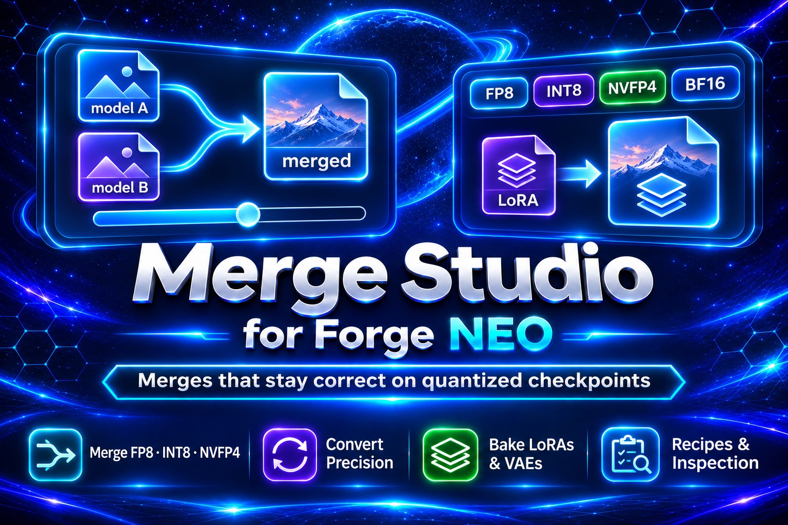

<p align="center">
  
</p>

# 🔀 Merge Studio

<div align="center">

[](https://github.com/Haoming02/sd-webui-forge-classic/tree/neo)
[](https://gradio.app/)
[](https://github.com/eduardoabreu81/sd-webui-merge-studio/releases)
[](LICENSE)
[](https://github.com/eduardoabreu81/sd-webui-merge-studio/wiki)

> **Model merging, conversion, LoRA baking, and inspection for [Stable Diffusion WebUI Forge Neo](https://github.com/Haoming02/sd-webui-forge-classic/tree/neo)** · **[📖 Full documentation on the Wiki](https://github.com/eduardoabreu81/sd-webui-merge-studio/wiki)**

</div>

Merge Studio brings the most useful model-management tools into a single Forge Neo tab. Merge compatible checkpoints, convert model precision, bake LoRAs and VAEs, inspect model metadata, save reusable recipes, and repair common quantization metadata issues without leaving the WebUI.

Unlike traditional checkpoint mergers, Merge Studio can work with the quantized models that Forge Neo already knows how to load — including FP8, INT8, NVFP4, and ConvRot formats.

---

## ✨ Why Merge Studio?

- **One workspace** — merge, convert, bake, inspect, and repair models from the same extension.
- **Quantization-aware** — process supported quantized checkpoints instead of being limited to FP16 and BF16 files.
- **Forge-native** — uses Forge Neo's own model and LoRA loading paths for consistent compatibility.
- **Reusable workflows** — save a complete setup as a recipe and load it again later.
- **Safer merges** — architecture checks and clear warnings help prevent incompatible combinations.
- **Fast inspection** — read model, LoRA, VAE, and text-encoder metadata without loading the full file into memory.

---

## 🆕 What's New

### v0.6.0 - FLUX.2 [klein] and Iris-Z Quantization

- **FLUX.2 quantization profile** - INT8 ConvRot and W4A8 builds of FLUX.2 [klein] 9B and Iris-Z, quantizing the same layers as the published official builds
- **Iris-Z recognised** - named in the inspectors, and FLUX.2 [klein] and Iris-Z listed among the newer models

---

## 📖 Changelog

### v0.6.0 - FLUX.2 [klein] and Iris-Z Quantization

- **FLUX.2 quantization profile** - INT8 ConvRot and W4A8 builds of FLUX.2 [klein] 9B and Iris-Z, quantizing the same layers as the published official builds
- **Iris-Z recognised** - named in the inspectors, and FLUX.2 [klein] and Iris-Z listed among the newer models

### v0.5.0 - LoRA Workflow and Reliability

- **LoRAs merged and baked in float32**, so small deltas survive
- **Real LoRA names and architectures** in the dropdowns, and **LoRA rows filled from a pasted prompt**
- **Cancel** a running merge, bake or conversion, and a **Clear All** button on the merge tab
- **Krea 2 builds can quantize their text stage** too
- **Less memory**: every parameter merged, unused models skipped, a bake's peak RAM halved, memory freed before and during a merge
- **FP32 sources keep their precision** when quantizing, and LoRA files are read directly now that Forge Neo dropped `load_lora_state_dict`

### v0.4.0 - The Newer Architectures

- **Recognises FLUX 3, MOSS-Image, Iris 3B, Qwen-Image 2.1 and FIBO 2**, with their text encoders and VAEs
- **Quantizes them the way their official builds do**, keeping the precision of the layers a quantized output leaves alone
- **Reads the quantization a checkpoint declares** in its metadata

### v0.3.0 - Merge Modes, LoRA Merge and History

- **Merge modes in one table, with three new ones**, and **per-block weights** where they can act
- **DARE merges are repeatable**: the seed is shown and saved
- **LoRA merge**: several LoRAs into one, on a tab of its own
- **Reads the recipes other tools write**, including ComfyUI's ModelMergeSimple, and **draws the merge history** a checkpoint records
- **Architectures named by Forge's own detector**, and a checkpoint Forge cannot fully load is refused before merging

### v0.2.0 - AIO Checkpoints

- **Self-contained checkpoints** that load with no Additional Modules, built from components Forge preflights
- **Component precision and provenance preserved**, and every AIO **validated by reopening it**
- **Recipe v2** records AIO compositions

### v0.1.0 - First Release

- **Checkpoint merge, precision conversion, LoRA and VAE baking** in one Forge Neo tab
- **Cross-generation Anima merges** with block remapping
- **Recipes** saved and loaded as JSON
- **Inspector** for checkpoints, LoRAs, text encoders and VAEs, telling ConvRot INT8 apart from plain INT8

---

## 📦 Installation

1. Open Forge Neo WebUI.
2. Go to **Extensions** → **Install from URL**.
3. Paste:

```text
https://github.com/eduardoabreu81/sd-webui-merge-studio
```

4. Click **Install**.
5. Reload or restart the WebUI.
6. Open the new **Merge Studio** tab.

> [!IMPORTANT]
> Merge Studio is built for **Forge Neo** and follows the model support provided by Forge Neo itself.

---

## 🎯 What it does

| Feature | In short | Details |
| :--- | :--- | :--- |
| **Checkpoint merge** | Six modes, from a plain blend to DARE. The form shows only the models and sliders the chosen mode actually uses. | [Merge Modes](../../wiki/Merge-Modes) |
| **Convert & quantize** | Pick a precision per component — diffusion model, text encoder, VAE — and rebuild the file. | [Quantization and Formats](../../wiki/Quantization-and-Formats) |
| **AIO checkpoints** | Build a self-contained checkpoint that loads with no Additional Modules, and have it verified by reopening. | [AIO Checkpoints](../../wiki/AIO-Checkpoints) |
| **LoRA & VAE baking** | Bake up to 10 LoRAs and a custom VAE into a checkpoint, each at its own strength. | [LoRA Tools](../../wiki/LoRA-Tools) |
| **LoRA merge** | Combine up to six LoRAs into one adapter, exactly, on a tab of its own. | [LoRA Tools](../../wiki/LoRA-Tools) |
| **Anima merges** | Merge across Anima generations with automatic block mapping, and weight chosen layers differently from the rest. | [Anima Merges](../../wiki/Anima-Merges) |
| **Recipes** | Save the whole setup as JSON and load it back, including an AIO's components and a DARE seed. | [Recipes and Inspector](../../wiki/Recipes-and-Inspector) |
| **Inspector** | Read architecture, components, lineage, baked LoRAs and raw metadata — including merges made in other tools. | [Recipes and Inspector](../../wiki/Recipes-and-Inspector) |
| **Quant Format Doctor** | Diagnose and repair missing quantization metadata before it becomes a loading error. | [Quantization and Formats](../../wiki/Quantization-and-Formats) |

---

## 🚀 Quick Start

### Merge two checkpoints

1. Open **Merge Studio** → **Checkpoint Merge & Studio**.
2. Select the primary model in **Model A**.
3. Pick a merge mode and fill the models it asks for.
4. Set the output name, multiplier, precision, and save mode.
5. Click **Merge / Process**.

Changed your mind? **Cancel**, next to the button, stops the job and saves nothing. It takes effect at the next step, so a model that is still loading finishes loading first. Once the file is being written, it can no longer be cancelled.

Starting something new? **Clear All** resets the whole tab, including models and LoRAs left over from the last merge.

### Build an AIO (self-contained) checkpoint

1. Select the model in **Model A**.
2. Set **Save Mode** to **AIO**.
3. Fill every component row that appears — pick a file, or keep what the checkpoint already has.
4. Click **Merge / Process**.

The result is reported as an AIO only after it reopens with no external modules.

### Convert or quantize a model

1. Select the source checkpoint in **Model A**.
2. Choose **No Interpolation**.
3. Select the desired output precision for each component.
4. Enter an output name and click **Merge / Process**.

**Krea 2 at INT4, INT8, W4A8 or W6A8:** an extra option, **Also quantize the text stage**, appears when it makes a difference. Left off, the part of the model that prepares your prompt stays at full precision. Turned on, the file is about 0.5 GB smaller at 4 bits. Published Krea 2 builds do it both ways, so try the same seed on each to see which you prefer.

### Bake LoRAs

1. Expand **Bake LoRA(s) into Checkpoint**.
2. Select a LoRA and set its strength, using **Add LoRA** for more.
3. Click **Merge / Process**.

Already have the LoRAs in a prompt? Paste it, or just its `<lora:name:weight>` tags, into **Paste LoRAs from a prompt** and every LoRA fills its own row with its weight. Any name not found in your LoRA folder is listed so you can pick it by hand. The **LoRA Merge** tab has the same box.

LoRAs are listed by their real name when one is available (from CivitAI, or the name given when it was trained), with the model type it was made for and the file name beside it, like `Detail Tweaker XL · v2.0 · xl — add-detail-xl`. Type any part of it to filter the list. If a LoRA was made for a different model type than the Primary Model, a warning tells you before the bake.

**Merge precision → FP32** keeps changes a BF16 checkpoint would round away, which is what turbo and DMD LoRAs carry. The diffusion model is upcast, the merge and the LoRA math run in float32 on any device (Forge's own LoRA math is float16 on most GPUs), and the output is quantized straight from that result. It takes about twice the RAM. A bf16 Model A gets the most out of it; pair that with an **FP32** or quantized output, since **Same as source** rounds the result back to bf16. An already-quantized Model A (e.g. int8 ConvRot) works too: its quantized layers are patched in float32 and requantized once — keep **Same as source** there to avoid quantizing them a second time — but what its own quantization lost does not come back.

An FP32 merge saved to disk makes a good master for your quantized builds. Merge Studio loads an FP32 checkpoint in FP32 when you quantize it, or when you use it with **Merge precision → FP32**, so the extra precision is still there when the quantized versions are made. Left to itself, Forge Neo would load it as BF16 first.

**One merge, many quantized builds:**

1. Bake your LoRAs with **Merge precision → FP32** and **Output format → FP32**. This file is your master.
2. For each build you want (INT8 ConvRot, W6A8, W4A8...), select the master as the Primary Model, choose **No Interpolation**, keep **Merge precision → FP32**, and pick the output format.
3. Always start from the master, never from a build that is already quantized. Quantizing a quantized file rounds the weights twice.
4. Keep the master while you are still making builds or comparing them. Without it, every new format means baking the LoRAs again.

A build made from the master comes out the same size as one made from a BF16 checkpoint. If you only need one format, you can skip the master and bake straight into it with **Merge precision → FP32**: the result is the same.

### Inspect a model

1. Open **Model Recipe & Inspector**.
2. Select any available checkpoint, LoRA, text encoder, or VAE.
3. Review its identity, components, lineage, and metadata.

### Repair quantization metadata

1. Open **Quant Format Doctor**.
2. Select the model and click **Diagnose**.
3. If a known issue is found, choose whether to repair in place or create a copy.

---

## ✅ Compatibility

Merge Studio supports the model families and file formats that Forge Neo can load through its standard checkpoint system.

| Workflow | Support |
| :--- | :--- |
| Convert, quantize, or bake a single model | Any compatible model Forge Neo can load |
| Merge checkpoints | Models with compatible architectures and tensor shapes |
| Weight layers individually | Anima checkpoints |
| Cross-generation Anima merge | Supported when the newer, larger model is Model A |
| Merge LoRAs into one LoRA | Plain LoRA / LoCon adapters of the same architecture |
| Read a merge made in another tool | Recipes written by other mergers, and ComfyUI workflows |
| Build an AIO checkpoint | Any architecture Forge Neo declares components for; verified by reopening |
| Inspect safetensors metadata | Checkpoints, LoRAs, text encoders, and VAEs |

**Output formats:** FP16, BF16, FP32, FP8 e4m3fn, FP8 e5m2, MXFP8, INT8, INT8 ConvRot, NVFP4, INT4 ConvRot W4A4, W4A8, W6A8, or same as the source.

**Choosing for speed:** W4A8 and W6A8 need an NVIDIA RTX 30 series card or newer for full speed. On older NVIDIA cards, they generate more slowly than INT8 or W4A4, so choose one of those if speed matters most.

### 🆕 Newer models

Merge Studio recognizes these models, keeps them apart from older families with similar names, and knows their text encoders and VAEs:

| Model | Works with |
| :--- | :--- |
| **Krea 2** | Forge Neo |
| **Qwen-Image 2.1** | Forge Neo, or the [Qwen-Image 2.1 extension](https://github.com/eduardoabreu81/qwen2.1-forge-neo) |
| **FLUX 3 Klein** | The [FLUX 3 extension](https://github.com/eduardoabreu81/flux3-image-forge-neo) |
| **MOSS-Image** | Forge Neo, or the [MOSS-Image extension](https://github.com/eduardoabreu81/moss-image-forge-neo) |
| **Iris 3B** | The [Iris 3B extension](https://github.com/eduardoabreu81/iris-3b-forge-neo) |
| **FIBO 2** | The [FIBO 2 extension](https://github.com/eduardoabreu81/fibo2-forge-neo) |
| **FLUX.2 [klein] 9B** | Forge Neo |
| **Iris-Z** | The [Iris-Z extension](https://github.com/eduardoabreu81/iris-z-forge-neo) |

When you quantize one of them from full precision, Merge Studio converts the same layers the official quantized releases do and leaves the sensitive ones (inputs, outputs, timing and text layers) at full precision. A model that is already quantized keeps its own layout.

> [!TIP]
> The [INT8 ConvRot and W4A8 builds of Iris-Z-small](https://huggingface.co/eduardoabreu81/iris-z-small-quantized) were made with Merge Studio. Quantize Iris-Z with the Iris-Z extension installed: Forge Neo alone does not load its depth layer, and the result would miss it.

> [!NOTE]
> Building an AIO checkpoint for Qwen-Image 2.1, FLUX 3, MOSS-Image, Iris 3B or FIBO 2 is still marked experimental.

**Not supported:** GGUF, Nunchaku / SVDQuant, NF4 and legacy bitsandbytes storage, and SD2 / SD3 — none of which Forge Neo's current model loader handles.

---

## ⚠️ Before you merge

- **Keep the originals** until you have generated with the result. A merge that loads is not the same as a merge that works.
- **Anima 3.8B v1.1 is refused.** It carries a Semantic Connector that Forge Neo drops on load, so the saved result would be missing it. The merge is blocked with a message naming what was found. Use the plain Anima 3.8B instead.
- **For cross-generation Anima merges, Model A must be the newer model with more blocks**, and Blend and Delta are not interchangeable at the same number — Delta moves roughly sixteen times less. See [Anima Merges](../../wiki/Anima-Merges).
- **Compatibility checks are not exhaustive.** Merge Studio blocks the mismatches it knows about, but it cannot safely guess every new or uncommon architecture.
- **Quantizing a VAE** affects image quality more than quantizing the diffusion model. FP16 or BF16 is the safest choice.
- **Large models need a lot of memory.** A merge holds both models at once, and Krea 2 is about 24 GB each in BF16, twice that in FP32. Merge Studio unloads the current checkpoint first, and your next generation loads it back. If Forge closes in the middle with no message, it most likely ran out of memory: give Windows more virtual memory, with a fixed size rather than an automatic one.
- **Some models keep the text encoder and VAE separately.** Make sure the required files are selected under Forge Neo's Additional Modules, even when saving only the diffusion model.

Things that went differently than expected are collected in
**[Troubleshooting](../../wiki/Troubleshooting)**.

---

## 📚 Documentation

This README covers installation and everyday use. The reference material —
merge methodology, architecture notes, model-specific behaviour, quantization
details and troubleshooting — lives in the
**[Wiki](https://github.com/eduardoabreu81/sd-webui-merge-studio/wiki)**.

---

## 🙏 Credits

- Built for **[Forge Neo](https://github.com/Haoming02/sd-webui-forge-classic/tree/neo)** by Haoming02.
- Anima cross-generation mapping follows Forge Neo's own mapping tables.
- Additional Anima mapping research was informed by **[ComfyUI-Anima-Remap](https://github.com/shin131002/ComfyUI-Anima-Remap)** by shin131002.
- The **Delta** write rule for inserted blocks follows **[Anima Delta Mix](https://github.com/bestluner-create/Anima-Delta-Mix)** by bestluner-create, whose block maps were verified to agree with Forge Neo's.
- **Similarity Add Difference** is ported from **[meh](https://github.com/s1dlx/meh)** by s1dlx (MIT, Copyright © 2023 s1dlx).
- **DARE** is written from *[Language Models are Super Mario](https://arxiv.org/abs/2311.03099)* (Yu et al., arXiv:2311.03099); **[safetensors-merge-supermario](https://github.com/martyn/safetensors-merge-supermario)** (MIT) was the reference implementation consulted.
- Weighted Sum, Add Difference and Sum Twice are written from the formulas **[SuperMerger](https://github.com/hako-mikan/sd-webui-supermerger)** publishes in its README. No code was taken from it.
- Released under the [MIT License](LICENSE).

---

<div align="center">

Made with ❤️ for the Stable Diffusion community

**[📖 Wiki](https://github.com/eduardoabreu81/sd-webui-merge-studio/wiki)** • **[Report Bug](https://github.com/eduardoabreu81/sd-webui-merge-studio/issues)** • **[Request Feature](https://github.com/eduardoabreu81/sd-webui-merge-studio/issues)** • **[☕ Ko-fi](https://ko-fi.com/eduardoabreu81)**

<sub>More Forge Neo extensions at <a href="https://eduardoabreu81.github.io/">eduardoabreu81.github.io</a></sub>

</div>
